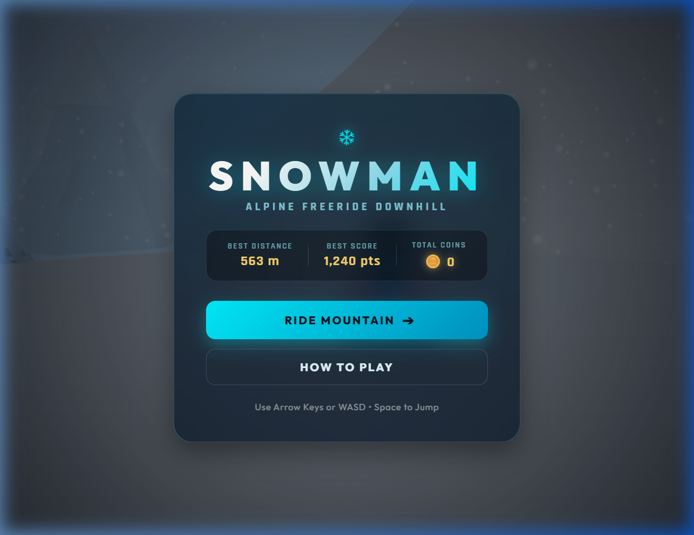
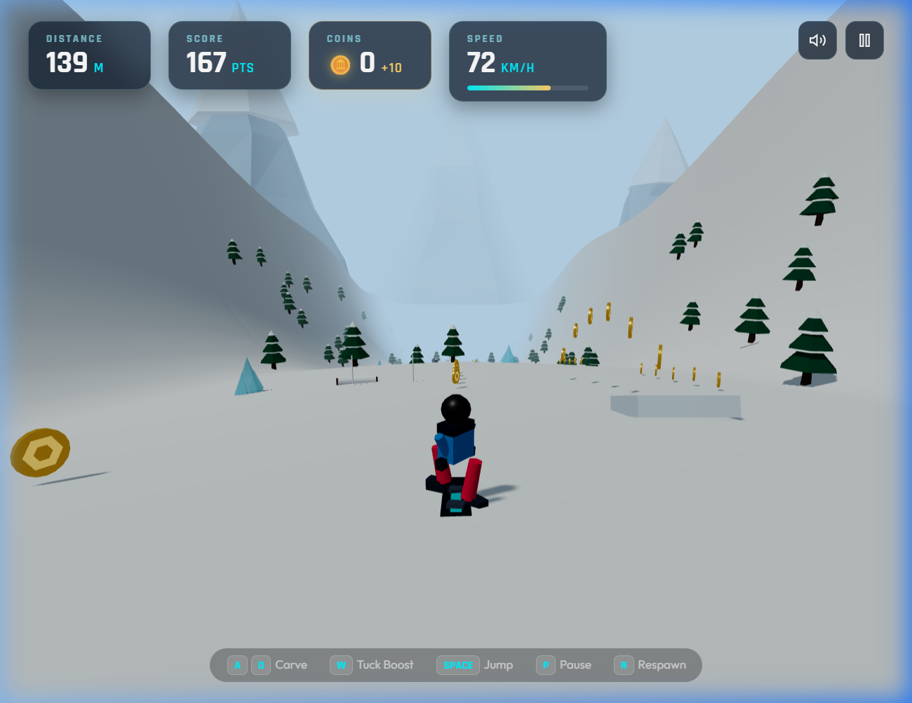
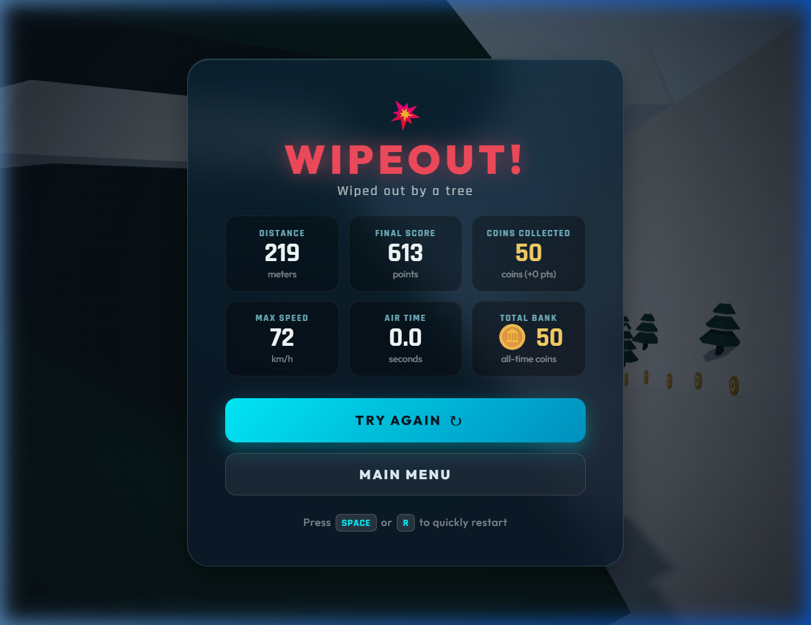

# SNOWMAN — 3D Alpine Freeride Downhill

[](https://threejs.org/)
[](https://developer.mozilla.org/en-US/docs/Web/API/Web_Audio_API)
[](LICENSE)
[](#development-roadmap)

An exhilarating 3D browser-based downhill snowboarding game built with **Three.js** and procedural **Web Audio API**. Carve down endless snowy peaks, dodge mountain obstacles, gather glowing gold coins, and catch massive air off natural snow kickers.

---

## Table of Contents

- [Screenshots](#screenshots)
- [Game Concept & Objectives](#game-concept--objectives)
- [Features Implemented](#features-implemented)
  - [Phase 1: Core Playable Engine](#phase-1-core-playable-engine)
  - [Phase 2: Obstacles & Collectible Coins](#phase-2-obstacles--collectible-coins)
- [Controls](#controls)
- [Gameplay Mechanics](#gameplay-mechanics)
- [Technology Stack](#technology-stack)
- [Project Structure](#project-structure)
- [Prerequisites & Running Locally](#prerequisites--running-locally)
- [Testing Instructions](#testing-instructions)
- [Development Roadmap](#development-roadmap)
- [Known Limitations](#known-limitations)
- [License](#license)

---

## Screenshots

| Main Menu & Records | Downhill Freeride & Coins | Wipeout Summary Screen |
| :---: | :---: | :---: |
|  |  |  |

---

## Game Concept & Objectives

In **SNOWMAN**, you control an alpine snowboarder descending down an endless procedural mountain run.
- **Survive**: Navigate between hazardous obstacles such as dense pine trees, jagged boulders, fallen logs, translucent ice monoliths, and snowmen.
- **Collect**: Carve through strings of rotating gold coins arranged in straight lines, rainbow kicker jump arcs, and rhythmic carving zig-zags.
- **Speed & Airtime**: Crouch into an aerodynamic tuck to reach speeds exceeding 100 km/h, and launch off kicker ramps for big air-time bonus multipliers.

---

## Features Implemented

### Phase 1: Core Playable Engine
- **Procedural Low-Poly Snowboarder**: Full 3D male rider featuring an insulated winter jacket, baggy snow pants, snowboard boots, mittens, helmet, and curved panoramic visor goggles with metallic reflection.
- **Snowboard Kinematics & Carving**: Automatic downhill acceleration with gravity slope following, board edge rolling up to 25°, body lean, and dynamic board snow carving spray.
- **Aerodynamic Tuck Boost**: Hold `W` or `↑` to drop into a low racing tuck, reducing aerodynamic drag and boosting top speed from ~72 km/h to over 100 km/h.
- **Ollie / Jump Mechanics**: Launch off the ground with vertical impulse, tucking the board up with balance arm flares and landing knee compression.
- **Continuous Mountain Generation**: Seamless 0-gap terrain chunks generated ahead and recycled behind using deterministic mathematical elevation functions.
- **Atmospheric Environment**: 1,800 animated swirling snowflakes, directional winter sunlight with soft PCF shadow maps, distant mountain silhouettes, and speed streaks.
- **Procedural Sound Engine**: Pure Web Audio API synthesis for snow carving hiss, rushing wind, jump launch whoosh, landing thuds, and UI chimes (zero external audio file dependencies).
- **Frosted Glassmorphism UI**: High-tech alpine interface featuring live distance, score, speedometer with tuck indicator, pause overlay, and game over screens.

### Phase 2: Obstacles & Collectible Coins
- **Varied Mountain Obstacles**:
  - **Pine Trees**: Tall evergreen conifers with snowy tips and shadow casting.
  - **Jagged Boulders**: Granite dodecahedron rocks with deformed facets and snow caps.
  - **Fallen Logs**: Horizontal weathered tree trunks lying across the run with curved snow blankets (clearable via jumping or steering).
  - **Ice Blocks**: Translucent glacier cyan crystalline pillars and spikes using physical transmission materials.
  - **Snowmen**: Classic three-sphere snowmen with carrot noses, coal eyes, alpine scarves, top hats, and twig arms.
- **Fair-Path Mountain Carving**: Terrain bands partition the fairway into lanes while systematically reserving clear navigable routes through every obstacle cluster.
- **Distance Difficulty Curve**: Obstacle density scales up smoothly as distance increases from the starting summit.
- **Collision Detection & Feedback**:
  - Real 3D geometric collision detection.
  - Full wipeout ragdoll tumbling, 30-particle snow blast explosion, camera shake, and detailed cause of wipeout (e.g. *"Wiped out by a fallen log"*).
  - Glancing blow stumble recovery with arm windmilling animation.
- **3D Rotating Gold Coins**:
  - Embossed snowflake emblem, specular metallic gold material, and floating hover bob.
  - Pattern generators: Downhill Lines, Rainbow Jump Arcs over ramps, and Carving Zig-Zags.
  - Rewards **+10 in-game coins** and **+50 score points** per coin.
  - Golden sparkle particle explosion and audio chime on collection.
  - Rhythmic coin combo bonus toasts when collecting coins in quick succession.
  - Live HUD coin counter and persistent `localStorage` all-time coin bank.

---

## Controls

| Keyboard Control | Action |
| :--- | :--- |
| <kbd>A</kbd> / <kbd>D</kbd> or <kbd>←</kbd> / <kbd>→</kbd> | Steer & Carve Left / Right |
| <kbd>W</kbd> or <kbd>↑</kbd> | Aerodynamic Tuck (Speed & Acceleration Boost) |
| <kbd>Space</kbd> | Ollie / Jump off snow or kicker ramps |
| <kbd>P</kbd> or <kbd>Esc</kbd> | Pause / Resume Game |
| <kbd>R</kbd> | Quick Respawn / Restart Run |

*Note: Dedicated touch and tilt mobile controls will be expanded in Phase 6.*

---

## Gameplay Mechanics

### Scoring
$$\text{Score} = \text{Distance Traveled} \times \text{Speed Multiplier} \times \text{Tuck Bonus} + \text{Coin Points} + \text{Airtime Bonuses}$$
- **Coins**: +50 Score Points & +10 Coins each.
- **Slalom Gates**: +500 Bonus Points for passing through red and blue slalom flags.
- **Air Time**: Landing jumps off kicker ramps rewards up to +400 bonus points depending on hang time.
- **Combos**: Gathering multiple coins in rapid succession triggers combo multipliers.

---

## Technology Stack

- **Core**: HTML5, Vanilla JavaScript (ES Modules), CSS3
- **3D Graphics Engine**: [Three.js](https://threejs.org/) (r160 via CDN import map)
- **Audio**: Web Audio API (procedural oscillator and noise synthesis)
- **Styling**: Vanilla CSS with glassmorphism, responsive flex/grid layouts, and Google Fonts (`Outfit`, `Rajdhani`)
- **Storage**: Browser `localStorage` for high scores, max distance, and coin bank

---

## Project Structure

```
snowman/
├── assets/
│   └── screenshots/
│       ├── menu.png
│       ├── gameplay.png
│       └── wipeout.png
├── js/
│   ├── audio.js         # Web Audio API sound synthesis engine
│   ├── environment.js   # Lighting, fog, snow particles, sparkles, speed lines
│   ├── game.js          # Main coordinator, camera, render loop & state machine
│   ├── player.js        # Low-poly snowboarder model, physics & animations
│   ├── terrain.js       # Infinite chunk generation, obstacles, coins & collisions
│   └── ui.js            # HUD updates, modals, notifications & LocalStorage
├── .gitignore
├── index.html           # Main HTML structure, import maps, and UI overlays
├── README.md            # Comprehensive project documentation
└── style.css            # Winter design system and responsive styles
```

---

## Prerequisites & Running Locally

The game runs locally with standard static web hosting and zero build steps.

1. **Clone the repository**:
   ```bash
   git clone https://github.com/ABHINAND-005/snowman.git
   cd snowman
   ```

2. **Start a local HTTP server**:
   Using Python:
   ```bash
   python -m http.server 8080
   ```
   Or using Node (`npx`):
   ```bash
   npx serve .
   ```

3. **Open in Browser**:
   Navigate to `http://localhost:8080/` in Chrome, Firefox, Safari, or Edge.

---

## Testing Instructions

1. **Launch**: Open `http://localhost:8080/` and verify that the main menu renders with 0 console errors.
2. **Free Ride**: Click **RIDE MOUNTAIN** and test steering with `A` and `D`.
3. **Tuck**: Hold `W` and verify that the speed gauge fills and the "TUCK BOOST" badge illuminates.
4. **Coins**: Steer through lines and rainbow arcs of gold coins to confirm +10 coin counter increments and sparkle effects.
5. **Jumping**: Hit a snow kicker ramp with `Space` and observe the airtime reward upon landing.
6. **Collision**: Deliberately ride into a pine tree, rock, fallen log, ice block, or snowman to test the wipeout ragdoll, snow blast explosion, and game-over telemetry.
7. **Pause & Restart**: Press `P` to pause and `R` or `Try Again` to restart smoothly.

---

## Development Roadmap

- [x] **Phase 1**: Core playable 3D game, character model, downhill kinematics, infinite terrain chunks, falling snow, audio synthesis, HUD.
- [x] **Phase 2**: Obstacle systems (trees, rocks, fallen logs, ice blocks, snowmen), fair path carving, distance difficulty curve, 3D rotating gold coins, collection patterns, and coin counters.
- [ ] **Phase 3**: Checkpoint system, time trial gates, and nitro boost mechanics.
- [ ] **Phase 4**: Expanded trick system (rotations, grabs, flips), trick scoring, and aerial animations.
- [ ] **Phase 5**: Advanced persistent progression, cosmetics shop, character customization, and detailed statistics.
- [ ] **Phase 6**: On-screen virtual joystick / touch controls for mobile and tablet devices, advanced audio settings.
- [ ] **Phase 7**: Final optimization, performance tuning, and polish.

---

## Known Limitations

- Mobile on-screen touch overlay buttons are scheduled for Phase 6 (keyboard controls are recommended for current phases).
- Nitro boost mechanics and checkpoint timers are scheduled for Phase 3.

---

## License

This project is licensed under the [MIT License](LICENSE).
